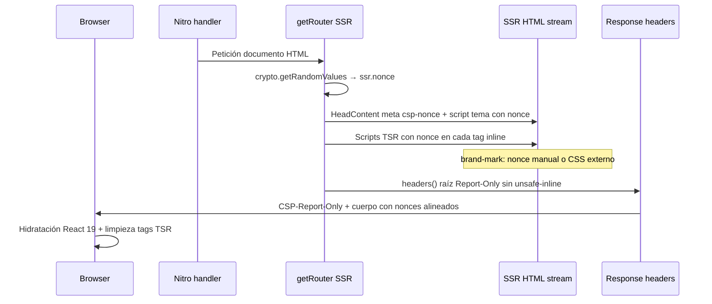

# Diseño U12B — nonce/hash CSP (VAP-27)

### Propósito de este documento

- **Objetivos:** Definir cómo sustituir `unsafe-inline` en `script-src` y
  `style-src` sin romper tema previo a hidratación, streaming TanStack Start y
  estilos del logotipo. Fijar un plan local reproducible y la evolución de
  Report-Only hacia U12C.
- **Estructura:** Decisión → superficies inline → hilo del nonce → hash
  complementario → cabeceras → fases Report-Only → pruebas locales ejecutadas →
  fuera de alcance.
- **Precede:** [Inventario U12A](./vap-27-csp-inventario-u12a.md). **No** activa
  CSP enforcing ni endpoints de informe.

## Estado

| Id         | Estado tras U12B                                                |
| ---------- | --------------------------------------------------------------- |
| **VAP-27** | **MITIGACIÓN_PENDIENTE** (diseño listo; implementación en U12C) |

U12B es **solo diseño y evidencia local**. El repositorio **no** cambia
`vercel.json`, código de producto ni cabeceras en producción.

## Decisión: nonce por petición (primario)

| Criterio                                  | Nonce por petición                                  | Hash estático (`'sha256-…'`)                      |
| ----------------------------------------- | --------------------------------------------------- | ------------------------------------------------- |
| Bootstrap TSR (`data-tsr-stream-part`)    | Apto: contenido distinto por ruta/estado            | **No apto**: payload variable                     |
| Script de límite (`$tsr-stream-boundary`) | Apto con el mismo nonce                             | Apto en teoría, pero irrelevante sin el bootstrap |
| `themeBootScript` en `<head>`             | Apto vía `headScripts` + `router.options.ssr.nonce` | Apto (contenido fijo en repo)                     |
| `BRAND_CSS` en SVG                        | Requiere acción explícita (ver § marca)             | Apto si el texto CSS no cambia                    |
| Cabecera CSP en Vercel estático           | **No**: `vercel.json` no puede interpolar nonce     | Solo hashes fijos conocidos                       |

**Conclusión:** el camino de implementación (U12C) debe generar un **nonce
criptográfico por respuesta HTML**, propagarlo al router TanStack y reflejarlo en
`Content-Security-Policy-Report-Only` (luego enforcing). Los hashes sirven como
**complemento de regresión** (p. ej. comprobar que `themeBootScript` no derivó) y
como vía alternativa de corto plazo **solo** para el tema si se retrasa el cableado
del nonce en SSR.

### Referencia de producto (TanStack)

El ecosistema TanStack documenta el patrón en el ejemplo
`e2e/react-start/csp` del monorepo Router:

1. Generar nonce en servidor dentro de `getRouter()` (p. ej.
   `createIsomorphicFn().server()` → `router.options.ssr.nonce`).
2. Emitir cabeceras CSP con `script-src` / `style-src` `'nonce-…'` desde la ruta
   raíz (`headers: ({ ssr }) => …`).
3. `HeadContent` / `<Scripts>` / streaming SSR aplican el mismo nonce a
   `<script>` y `<style>` gestionados por el router, e insertan
   `<meta property="csp-nonce" content="…">` para el cliente.

Vapelog ya usa TanStack Start 1.17x y Nitro; el contrato
`RequestOptions.context.nonce` en `@tanstack/start-server-core` permite pasar nonce
desde middleware Nitro si hiciera falta un segundo canal (no obligatorio si se
sigue el patrón de `getRouter()`).

## Superficies inline (inventario U12A)

| Superficie                | Ubicación                                                                           | Nonce (diseño)                                                                      | Hash (opcional)                                                                         |
| ------------------------- | ----------------------------------------------------------------------------------- | ----------------------------------------------------------------------------------- | --------------------------------------------------------------------------------------- |
| Tema previo a hidratación | `themeBootScript` en `src/routes/__root.tsx` → `src/components/ui/theme-toggle.tsx` | `head().scripts` recibe `nonce` automático cuando existe `router.options.ssr.nonce` | `'sha256-0WPvDIM2/fszVTTxw+90YSyofX0+ij3bVkyL/KyoEQU='` (build local 2026-11-10, 246 B) |
| Bootstrap hidratación     | TanStack `<Scripts>`, atributo `data-tsr-stream-part`                               | Propagado por `createHydrationScripts(nonce)`                                       | No recomendado                                                                          |
| Script de límite TSR      | Tras bootstrap, ~56 B                                                               | Mismo nonce en tags de streaming                                                    | No prioritario                                                                          |
| Entrada cliente           | `/assets/index-*.js` `type="module"`                                                | No inline; `'self'` basta                                                           | —                                                                                       |
| Estilos de marca          | `<style>{BRAND_CSS}</style>` dentro de SVG en `src/components/brand-mark.tsx`       | **No automático** — fuera de `RouterManagedTag`                                     | `'sha256-SBKdZ348bOCZ/5fHYZmtdGDGq/eRKOS1sNCzrAyDiS8='` (mismo build, 751 B)            |

**Riesgo de marca:** mantener CSS inline en SVG obliga a `style-src 'nonce-…'` o
`style-src 'sha256-…'` aunque el resto del HTML esté cubierto. La opción
**preferida en implementación** es **mover `BRAND_CSS` a `src/styles.css`** (o
módulo importado una vez) y eliminar el `<style>` del SVG, reduciendo duplicación
por instancia de logo y simplificando CSP.

## Hilo del nonce (diseño de implementación U12C)



### Pasos concretos (no aplicados en U12B)

1. **`src/router.tsx`:** en rama servidor, generar nonce (16–32 bytes, codificación
   segura para atributo HTML) y devolver `createRouter({ …, ssr: { nonce } })`.
   Debe ejecutarse **por petición**, no como constante de módulo.
2. **`src/routes/__root.tsx`:** añadir `headers: ({ ssr }) => …` que devuelva
   `Content-Security-Policy-Report-Only` con:
   - `default-src 'self'`
   - `script-src 'self' 'nonce-${nonce}'` (valorar `'strict-dynamic'` en fase
     posterior si el módulo de entrada lo exige)
   - `style-src 'self' 'nonce-${nonce}'` (o solo `'self'` si marca migra a hoja
     externa)
   - Mantener directivas actuales de `img-src`, `font-src`, `connect-src`,
     `frame-ancestors`, `base-uri` según inventario U12A.
3. **`brand-mark.tsx`:** o bien `const nonce = useRouter().options.ssr?.nonce` en
   servidor y `nonce={nonce}` en `<style>`, o migrar CSS (recomendado).
4. **Conflicto `vercel.json`:** mientras exista
   `Content-Security-Policy-Report-Only` estático con `unsafe-inline`, el
   navegador puede recibir **dos** políticas Report-Only. U12C debe **retirar
   `unsafe-inline` del JSON** cuando la cabecera dinámica sea fiable en Preview, o
   sustituir la regla estática por una versión sin `unsafe-inline` y dejar que la
   cabecera SSR aporte los nonces (orden y duplicidad a validar en Preview).
5. **Preview Vercel:** la barra de comentarios inyecta scripts; `e2e/preview`
   documenta violaciones Report-Only que no son fallo de la app. Filtrar en
   análisis o excluir dominio toolbar en fase de observación.

### Qué cubre TanStack sin código adicional

Con `router.options.ssr.nonce` definido:

- Scripts de cabecera declarados en `head().scripts` (incluye `themeBootScript`).
- Todos los tags de hidratación streaming y el script de límite en `<Scripts>`.
- Estilos inline gestionados por el manifest (`TSS_INLINE_CSS` si se activa en
  build).

## Evolución Report-Only (sin enforcing en U12B/U12C inicial)

| Fase         | Cabecera                                                                        | `unsafe-inline` | Criterio de avance                                                                      |
| ------------ | ------------------------------------------------------------------------------- | --------------- | --------------------------------------------------------------------------------------- |
| **R0** (hoy) | Solo `vercel.json` Report-Only                                                  | Sí              | Inventario U12A                                                                         |
| **R1**       | SSR añade segunda Report-Only con nonces; `vercel.json` aún con `unsafe-inline` | Mixto           | Comparar violaciones en Preview: las legítimas deben desaparecer en documento con nonce |
| **R2**       | Una sola Report-Only dinámica (quitar `unsafe-inline` de `vercel.json`)         | No              | `pnpm run smoke`, E2E Chromium, tema sin flash, rutas con loaders                       |
| **R3**       | Report-Only estricta estable ≥ N días                                           | No              | **Solo con aprobación operativa** (U12C): pasar a `Content-Security-Policy` enforcing   |
| **R4**       | Enforcing + (opcional) `report-uri` / endpoint                                  | No              | Requiere decisión de privacidad/retención; **fuera de U12B**                            |

No se añade `report-uri`, `report-to` ni colección de informes en U12B: observación
manual vía consola del navegador y cabeceras en Preview bastan hasta definir
retención y abuso.

### Política objetivo (borrador para R2, Report-Only)

```text
default-src 'self';
script-src 'self' 'nonce-{NONCE}';
style-src 'self' 'nonce-{NONCE}';
img-src 'self' data: blob:;
font-src 'self' data:;
connect-src 'self';
frame-ancestors 'none';
base-uri 'self';
```

`{NONCE}` sustituido por el valor de la petición. No incluye `'unsafe-inline'`.

## Plan local probado (2026-11-10)

Ejecutado en el workspace; **sin** cambios de código ni cabeceras CSP nuevas.

| Paso | Comando / acción                                                                | Resultado                                                                                               |
| ---- | ------------------------------------------------------------------------------- | ------------------------------------------------------------------------------------------------------- |
| 1    | Artefacto SSR existente `.output/server/index.mjs` (build previo)               | OK                                                                                                      |
| 2    | `PORT=34567 node .output/server/index.mjs` + `curl -sS http://127.0.0.1:34567/` | HTML ~30 972 B, estructura alineada con U12A                                                            |
| 3    | Inventario automático de `<script>` / `<style>`                                 | 4 scripts (1 tema, 1 TSR ~1061 B, 1 módulo externo, 1 límite 56 B); 1 `<style>` en SVG (`brand-voluta`) |
| 4    | Comprobación nonce actual                                                       | **Ningún** `nonce=` en inline (línea base pre-implementación)                                           |
| 5    | Hashes SHA-256 (regresión futura)                                               | Tema y marca: ver tabla § superficies                                                                   |
| 6    | `pnpm run smoke` contra servidor local                                          | **OK** (rutas críticas 200/404 esperado)                                                                |

### Comprobaciones previstas tras cablear nonce (U12C, no ejecutadas aquí)

1. Repetir pasos 2–4: **todos** los inline listados deben llevar el **mismo**
   `nonce` que la meta `csp-nonce` y la cabecera Report-Only.
2. Tema: sin parpadeo claro/oscuro con `localStorage` en `vapelog-theme` y
   preferencia sistema (`pnpm run visual-smoke` / E2E U9).
3. Navegación cliente tras primera carga: sin errores CSP en consola para scripts
   propios.
4. Rutas con datos (`/compatibilidad`, fichas con loaders): bootstrap TSR sigue
   presente y la página hidrata.
5. Preview Vercel: registrar violaciones de toolbar por separado de regresiones
   propias.

### Spike opcional de bajo riesgo (reversible)

Si se desea validar antes de U12C: rama local que solo añade `ssr.nonce` en
`getRouter()` + cabecera Report-Only en `__root` **sin** quitar
`unsafe-inline` de `vercel.json`, desplegar solo a Preview y contrastar HTML. Revertir
borrando la rama. U12B **no** aplica ese spike en `main`.

## Hash del script de tema (complemento CI)

El cuerpo del primer `<script>` inline del HTML servido coincide con
`themeBootScript` exportado (246 bytes UTF-8). Si cambia `STORAGE_KEY` o la lógica
del IIFE, actualizar el hash en tests o regenerar en el gate.

Verificación local:

```bash
# Tras build + curl del documento /
node -e "
const fs=require('fs'); const c=require('crypto');
const h=fs.readFileSync('home.html','utf8');
const b=h.match(/<script\\b[^>]*>([\\s\\S]*?)<\\/script>/i)[1].trim();
console.log(\"sha256-\"+c.createHash('sha256').update(b).digest('base64'));
"
```

En gate de regresión (propuesta): fallar si el hash del tema en HTML de smoke difiere
del esperado **y** no hay nonce (modo R0); en modo R1+, priorizar presencia y
unicidad de nonce frente al hash.

## Fuera de alcance (U12B)

- Activar `Content-Security-Policy` enforcing.
- Añadir endpoint o URL de informes CSP.
- Modificar `vercel.json` o código de producción.
- U12C: despliegue, retirada de `unsafe-inline` en estático y aceptación operativa.

## Referencias

- [Inventario U12A — VAP-27](./vap-27-csp-inventario-u12a.md)
- TanStack Router — `e2e/react-start/csp` y `packages/router-core/src/ssr/STREAMING.md`
- Fuentes Vapelog: `src/router.tsx`, `src/routes/__root.tsx`,
  `src/components/ui/theme-toggle.tsx`, `src/components/brand-mark.tsx`,
  `vercel.json`
